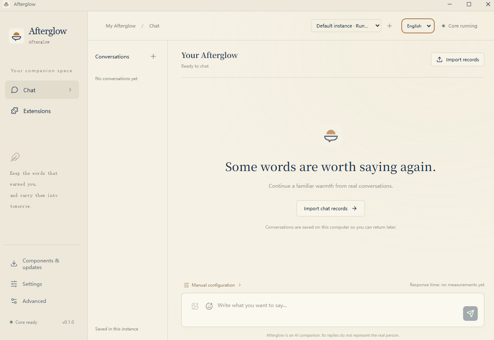

<p align="center">
  
</p>

<h1 align="center">Afterglow Desktop</h1>

<p align="center">
  <strong>Let the warmth of past conversations continue into companionship.</strong><br />
  通过真实聊天记录构建可检索的关系记忆、角色设定与表达风格。结合 RAG、角色上下文和兼容 OpenAI 的 API，让 AI 在新的对话中延续熟悉的交流方式。
  <br />
  The desktop app for Afterglow.
</p>

<p align="center">
  <a href="https://github.com/kldhsh123/Afterglow-Desktop/releases">Download for Windows</a>
  ·
  <a href="https://github.com/kldhsh123/Afterglow">Afterglow Core</a>
  ·
  <a href="CONTRIBUTING.md">Contributing</a>
</p>

<p align="center">
  <a href="https://discord.gg/CKrvgCyK4y">Discord</a> ·
  <a href="https://qm.qq.com/cgi-bin/qm/qr?k=7rvmrvR100Is9aAp0ZsjmfiG7e0Cv6ZB&amp;jump_from=webapi&amp;authKey=mEN/epjvPHcT+Sb61/XO0Mi5egs2xJBhZm9Wm5MmgEWrpNa0ZOY3fzUf+pvqfijD">QQ community</a>
</p>

<p align="center">
  <a href="README/README.zh-CN.md">简体中文</a>
</p>

---

## What is Afterglow?

[Afterglow](https://github.com/kldhsh123/Afterglow) is a locally hosted AI companion. It builds retrievable relationship memories, persona and expressive style from real chat history. RAG, persona context and an OpenAI-compatible API bring familiar conversational patterns into new exchanges.

It cleans, splits and vectorizes real chats, then combines persona, circadian patterns, Life state and relationship memories to supply relevant historical evidence to a chat model.

## Afterglow on the Desktop

**Afterglow Desktop is the Windows desktop app for Afterglow.** It bundles the original core and portable Python, bringing guided configuration, model connections, chat-history import, chat and analysis into one interface. Each installation can keep its own configuration and data.



## Features

- **Guided setup** — Configure your environment through an integrated onboarding flow.
- **Chat interface** — Interact with your configured AI services from the desktop.
- **Chat-history import** — Bring existing conversations into Afterglow.
- **Conversation analysis** — Explore and process imported chat history.
- **QQ and WeChat extensions** — Extend functionality through bundled integrations.
- **Isolated installations** — Keep configuration and data separate for each installation.

## Getting Started

1. Download the latest Windows x64 installer or portable release from [GitHub Releases](https://github.com/kldhsh123/Afterglow-Desktop/releases).
2. Launch the application and select your language.
3. Follow the setup wizard to configure your environment and model-service credentials.

**Requirements**

- Windows x64
- Microsoft Edge WebView2 Runtime
- Credentials for the model services you choose

Python and the Afterglow core are bundled with the application. A separate Python installation is not required.

macOS is not currently supported.

## Architecture

```text
Vue 3 + TypeScript
        │
     Tauri IPC
        │
Tauri 2 + Rust
        │
  Private local IPC
        │
Portable Python Host
        │
Extensions + Afterglow Core
```

| Directory | Responsibility |
| --- | --- |
| `src/` | UI, onboarding, chat, and settings |
| `src-tauri/` | Native windows, tray, process lifecycle, and OS integration |
| `desktop_host/` | Configuration, imports, model connections, extensions, and core management |
| `locales/` | English and Simplified Chinese translations, including installer text |
| `scripts/` | Runtime preparation, version synchronization, and Windows packaging |

The desktop application reuses the retrieval, memory, import, and analysis capabilities of [kldhsh123/Afterglow](https://github.com/kldhsh123/Afterglow).

See [THIRD_PARTY_NOTICES.md](THIRD_PARTY_NOTICES.md) for third-party source and license attribution.

## Development

**Prerequisites:** Node.js/npm, Rust, the Tauri Windows prerequisites, and Python 3.12.

Full desktop development also requires prepared Windows Python and core resources. See [`scripts/prepare_windows.py --help`](scripts/prepare_windows.py) and the [contribution guide](CONTRIBUTING.md).

```bash
npm ci
npm run dev
npm test
python3 -m unittest discover -s tests -p 'test_*.py'
```

`npm run dev` starts a browser preview. It does not include native desktop functionality or core integration.

To run the full desktop application, use `npm run desktop:dev` in a configured Windows development environment.

## License

[AGPL-3.0-or-later](LICENSE).

Third-party components retain their respective licenses. Contributions are subject to the [contribution agreement and code ownership terms](CONTRIBUTING.md#contribution-agreement-and-code-ownership).

## Links

[Linux.do](https://linux.do/)
