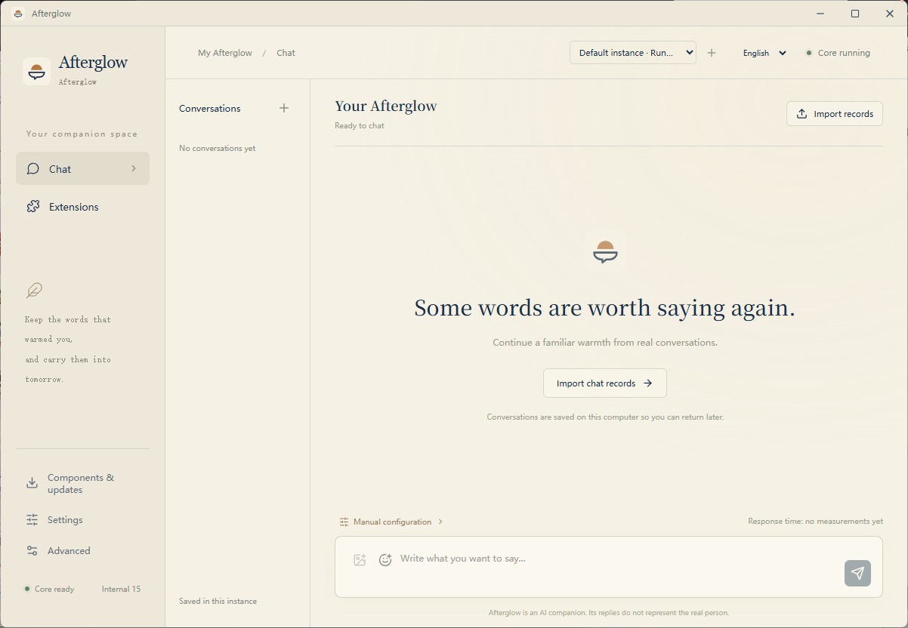

<p align="center">
  
</p>

<h1 align="center">Afterglow Desktop</h1>

<p align="center">
  <strong>把曾经对你好的话，续成往后的陪伴。</strong>
  <br />
  Afterglow 的桌面端。
</p>

<p align="center">
  <a href="https://github.com/kldhsh123/Afterglow-Desktop/releases">下载 Windows 版</a>
  ·
  <a href="https://github.com/kldhsh123/Afterglow">Afterglow 核心</a>
  ·
  <a href="CONTRIBUTING.zh-CN.md">贡献指南</a>
</p>

<p align="center">
  <a href="https://discord.gg/CKrvgCyK4y">Discord</a> ·
  <a href="https://qm.qq.com/cgi-bin/qm/qr?k=7rvmrvR100Is9aAp0ZsjmfiG7e0Cv6ZB&amp;jump_from=webapi&amp;authKey=mEN/epjvPHcT+Sb61/XO0Mi5egs2xJBhZm9Wm5MmgEWrpNa0ZOY3fzUf+pvqfijD">QQ 交流群</a>
</p>

<p align="center">
  <a href="../README.md">English</a>
</p>

---

## Afterglow 是什么

[Afterglow](https://github.com/kldhsh123/Afterglow) 是一个本地运行的 AI 朋友系统。从真实历史聊天中构建可检索的关系记忆、人格与表达风格，通过 RAG + Persona + OpenAI 兼容 API，让熟悉的语气继续留在对话里。

它把真实聊天记录清洗、切分并向量化，再结合 persona、作息画像、生活状态与关系记忆，为主模型提供和当前对话相关的历史证据。

## Afterglow 的桌面端

**Afterglow Desktop 是 Afterglow 的 Windows 桌面端。** 程序自带原版核心和便携 Python，将配置向导、模型连接、聊天记录导入、聊天与分析整合到一个界面。不同安装目录可以分别保存配置和数据。



## 功能

- **配置向导** — 按步骤完成运行环境和模型服务配置。
- **聊天界面** — 在桌面程序中直接与配置好的 AI 服务对话。
- **聊天记录导入** — 将已有聊天记录导入 Afterglow。
- **聊天记录分析** — 分析和查看导入记录中的关系、人格与表达习惯。
- **QQ 和微信扩展** — 程序自带相关集成功能。
- **独立安装实例** — 不同安装目录分别保存配置和数据。

## 开始使用

1. 从 [GitHub Releases](https://github.com/kldhsh123/Afterglow-Desktop/releases) 下载 Windows x64 安装包或便携版。
2. 启动程序并选择语言。
3. 按配置向导完成运行环境和模型服务凭据设置。

**运行要求**

- Windows x64
- Microsoft Edge WebView2 Runtime
- 所选模型服务的 API 配置

程序自带 Python 和 Afterglow 核心，无需另外安装 Python。

暂不支持 macOS。

## 架构

```text
Vue 3 + TypeScript
        │
     Tauri IPC
        │
Tauri 2 + Rust
        │
    私有本地 IPC
        │
   便携 Python 宿主
        │
自带扩展 + Afterglow 核心
```

| 目录 | 职责 |
| --- | --- |
| `src/` | 界面、配置向导、聊天和设置 |
| `src-tauri/` | 原生窗口、托盘、进程管理和系统集成 |
| `desktop_host/` | 配置、导入、模型连接、扩展和核心管理 |
| `locales/` | 独立的中英文翻译，包含安装程序文案 |
| `scripts/` | 运行环境准备、版本同步和 Windows 打包 |

桌面程序直接复用 [kldhsh123/Afterglow](https://github.com/kldhsh123/Afterglow) 的检索、记忆、导入和分析能力。

第三方来源与许可说明见 [THIRD_PARTY_NOTICES.md](../THIRD_PARTY_NOTICES.md)。

## 开发

**开发依赖：** Node.js／npm、Rust、Tauri Windows 开发依赖和 Python 3.12。

完整桌面开发还需要准备 Windows Python 和核心资源。详见 [`scripts/prepare_windows.py --help`](../scripts/prepare_windows.py) 和[贡献指南](CONTRIBUTING.zh-CN.md)。

```bash
npm ci
npm run dev
npm test
python3 -m unittest discover -s tests -p 'test_*.py'
```

`npm run dev` 启动浏览器预览，不包含原生桌面功能或核心集成。

在已配置的 Windows 开发环境中，使用 `npm run desktop:dev` 运行完整桌面程序。

## 许可证

[AGPL-3.0-or-later](../LICENSE)。

第三方组件保留各自许可证。贡献适用[贡献协议与代码所有权条款](CONTRIBUTING.zh-CN.md#贡献协议与代码所有权)。
